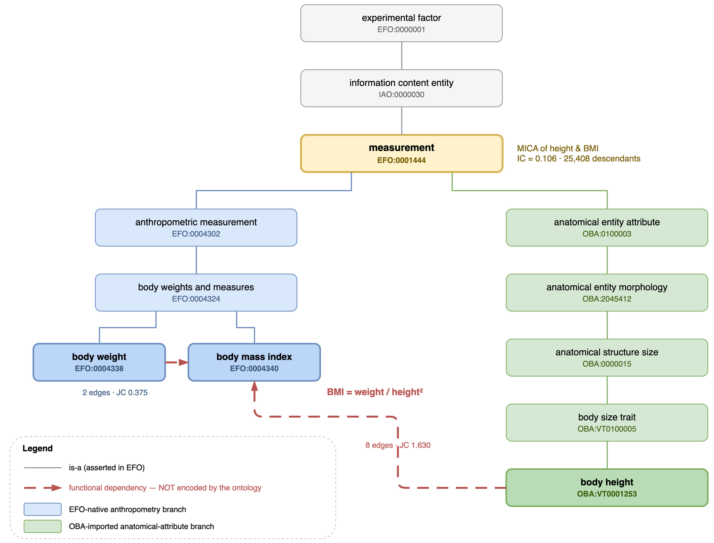

# Ontology distance and functional dependence

The earlier manuscript compared height–BMI and weight–BMI distances in an EFO hierarchy. Its original supplement and figure are preserved in `paper/recovery/manuscript/`. They are historical working material, not a validated current ontology snapshot.

## Information content and Jiang–Conrath distance

Corpus-based information content uses $IC(t)=-\log p(t)$, with the population of annotations and ancestor propagation rule specified. Jiang–Conrath distance combines the IC of the two terms and their most informative common ancestor (MICA): \cite{jiang1997}

$$
d_{JC}(a,b)=IC(a)+IC(b)-2IC(\operatorname{MICA}(a,b)).
$$

IC is an input to this distance, not a competing distance measure. Without a corpus, an intrinsic IC convention can be chosen, but its values describe the selected ontology structure rather than observed annotation frequencies. \cite{seco2004}

## Unequal paths do not rule out equal distances

Let $h,w,b$ denote height, weight, and BMI. Write $m_h=\operatorname{MICA}(h,b)$ and $m_w=\operatorname{MICA}(w,b)$. Subtraction gives

$$
d_{JC}(h,b)-d_{JC}(w,b)
=IC(h)-IC(w)+2\bigl(IC(m_w)-IC(m_h)\bigr).
$$

Equality is possible when these terms cancel. Tree path lengths alone do not determine them.

For a concrete abstract example, let a general ancestor $m_h$ contain height and a branch $m_w$ containing weight and BMI. Assign propagated probabilities

$$
p(m_h)=1,\quad p(m_w)=\tfrac12,\quad
p(h)=\tfrac12,\quad p(w)=\tfrac18,\quad p(b)=\tfrac14.
$$

These can arise from 200 records: 100 annotated to height, 25 to weight, 50 to BMI, and 25 to another descendant of $m_w$, with each annotation propagated to its ancestors. With base-two logarithms, $IC(h)=1$, $IC(w)=3$, $IC(b)=2$, $IC(m_h)=0$, and $IC(m_w)=1$. Thus both distances equal $3$, despite the differing common ancestors. This is an illustrative taxonomy and corpus, not an empirical EFO result.

## What the comparison can establish

Even equal distances would not encode $B=W/H^2$. Conversely, unequal distances do not refute that equation. Taxonomic similarity and functional dependence answer different questions.

The original draft's claims that no corpus could equalize the distances, and that BMI is symmetric in height and weight, should not be reused. BMI uses both inputs but assigns them different roles. Any numerical EFO comparison also needs a pinned ontology version, an explicit edge-counting convention, and a specified IC estimator.


## Recovered historical diagram

The diagram below is retained to connect this draft to the recovered manuscript. Its counts and hierarchy are an unpinned historical snapshot. Its annotation about what the ontology does not encode was not established by a complete axiom audit; the diagram does not prove an impossibility result for corpus-based distances.

```latex
\begin{figure}[htbp]
\centering
{{fig:efo_bmi_tree}}
\caption{Historical working diagram of height, weight, and BMI. Preserved from the recovered manuscript; numerical and ontology-wide claims require validation against a pinned release.}
\label{fig:efo_bmi_tree}
\end{figure}
```

<!-- document-sanity:preview:begin hash=74f5447b -->

<!-- document-sanity:preview:end -->
